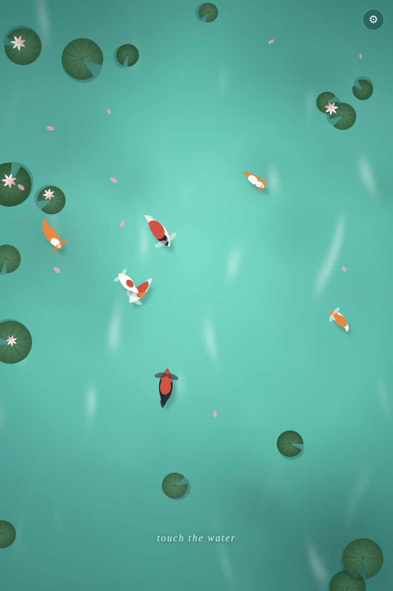

# Koi Pond

An interactive, procedurally animated koi pond that runs entirely in your browser. No libraries, no build step, no assets - every fish, lily pad and ripple is drawn and animated by code on a plain HTML canvas.



## Run it

Open `index.html` directly in any modern browser, or serve the folder:

```bash
npx serve .
# or
python3 -m http.server 8000
```

## Interacting with the pond

- **Touch / click and hold** - nearby koi turn and swim over to investigate your finger.
- **Drag** - draw a trail of ripples across the water.
- **Quick tap** - startle the koi; fish near the tap dart away.

Works with mouse on desktop and touch on mobile.

## Settings

Tap the gear in the top-right corner:

- **Weather**: Sunny, Cloudy, or Rain (raindrops ripple across the surface).
- **Time**: Day, Sunset, or Night (moonlit water and fireflies).

Your choice is saved in the browser. You can also share a configured pond via URL, e.g. `?weather=rain&time=night`.

## How it works

- **Lifelike procedural koi**: each fish gets a random size, speed, depth and pattern across 7 varieties (kohaku, kohaku-orange, hi, showa, calico, shiro utsuri, yamabuki). Bodies are shaped like real koi - blunt snout, full shoulders, slim tail wrist - with eyes, mouth barbels, fan-shaped pectoral and pelvic fins with fin rays, a dorsal ridge, a forked flowing tail, faint scale rows and soft-edged markings. No two ponds are the same.
- **Spine-based animation**: a fish is a chain of spine points that follow the head, with a traveling wave layered on top - the head stays almost still while the tail sweeps wide, like a real swimming fish. The body, fins and markings are drawn around that spine every frame, and each fish swims at its own depth with a matching shadow and underwater tint.
- **Behavior**: fish wander with smooth noise steering, avoid the edges, are attracted to an active touch point, and dart away when startled.
- **Water**: a layered radial-gradient background plus real-time light caustics computed per-pixel on a small offscreen buffer and composited with `screen` blending.
- **Scenery**: dense clusters of dark lily pads along the edges, leafy margin plants, red lotus flowers, drifting petals and fallen autumn leaves, all regenerated procedurally on every resize.
- **Weather & time**: rain generates live ripples; sunset and night regrade the whole scene; fireflies come out at night.
- **Self-contained**: zero dependencies, one small offscreen buffer for the light effects, wide-gamut (Display-P3) color where the browser supports it, and vector rendering that stays crisp on high-DPI and 4K screens.

## Files

```
index.html      - entry point
css/style.css   - page and hint styling
js/pond.js      - the whole simulation (~910 lines)
```

## Note

This is an original implementation inspired by procedural koi pond demos.

## License

MIT
